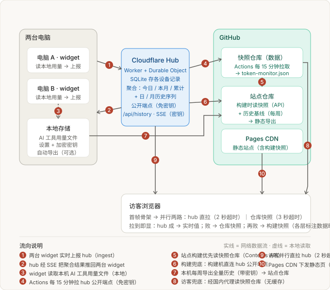

# token-monitor-data

Token Monitor hub 的多端用量**快照仓库**——每 15 分钟由 GitHub Actions 从 hub 公开端点（免密钥）拉取一次，写入 `token-monitor.json`。

- **数据来源**：Cloudflare Worker hub（`token-monitor-hub.saikouting004.workers.dev/api/public/stats`），聚合两台桌面设备上各 AI 工具的用量；公开端点已剥离设备与账号标识，只含聚合数字
- **为什么独立成仓**：个人网站（004Tingting/004Tingting.github.io）把它作为**离线兜底数据源**——hub 不可达时，站点构建与访客浏览器都读这里的快照，数据新鲜度不依赖站点重新发布
- **消费方**：① 站点构建 `scripts/fetch-token-stats.mjs`（优先读本仓库，失败才直连 hub）② 访客浏览器（hub 拉取失败时经国内 GitHub 代理读取）
- **手动刷新**：Actions 页 Manual Run，或本地 `node refresh.mjs` 后提交
- **失败语义**：hub 拉取失败时保留旧文件、不产生提交（与站点构建的降级路径一致）

## 数据流（脱敏）

两台桌面 widget 各自读取本机 AI 工具用量文件，实时上报 hub；hub 聚合成「今日 / 本月 / 累计」与日月历史序列。GitHub Actions 每 15 分钟把聚合结果拉进本仓库；站点构建优先读本仓库（Contents API），访客浏览器在 hub 拉取失败时经国内代理读本仓库，再失败才用构建快照。全量历史（370 天滚动窗口）由本机每周带密钥导出，提交到站点仓库。
